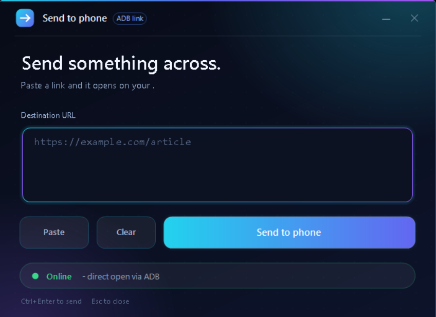

# Send to Phone

A small Windows desktop dialog that opens a link **directly on your Android phone** from your PC. No notification to tap, no matter what the phone is doing or which app is in the foreground.

It works over your phone's Wi-Fi hotspot (or any shared network) using ADB over TCP/IP, with KDE Connect as an automatic fallback.



> Built and tested on a Samsung Galaxy M34 5G, where Wi-Fi and hotspot can't run at the same time. That is why this uses ADB over the hotspot network instead of Android's built-in "Wireless debugging".

---

## Features

- Dark, modern dialog (PowerShell + WinForms, no extra installs)
- Paste, Clear and Send buttons; `Ctrl+Enter` sends, `Esc` closes
- Stays open so you can send many links in one session
- Opens the link straight in your default browser or app on the phone
- Live status pill: Online / Opened / Fallback / Failed
- Automatic fallback to a KDE Connect notification if ADB isn't reachable
- Finds the phone's hotspot address automatically

---

## How it works

1. Android only lets an app open pages from the background if it's in the foreground. KDE Connect on its own therefore just shows a "tap to open" notification.
2. ADB is allowed to start activities directly. The script runs `adb shell am start -a android.intent.action.VIEW -d <url>` on the phone.
3. ADB normally needs a USB cable. After one command (`adb tcpip 5555`) run **once while the cable is plugged in**, ADB listens on the network and the cable is no longer needed.
4. When the PC joins the phone's hotspot, the phone's address is the PC's default gateway. The script connects to `<gateway>:5555` automatically.
5. If ADB isn't reachable, the script sends the link through KDE Connect instead (you tap the notification).

---

## What's in this repo

| File | Purpose |
| --- | --- |
| `SendToPhone.ps1` | The dialog itself. Run this to send links. |
| `activate-adb.ps1` | Helper for the one-time activation step (`adb tcpip 5555`) with the USB cable plugged in. |
| `launch.vbs` | Optional launcher that starts `SendToPhone.ps1` with no console window. Keep it in the same folder as the script. |
| `requirements.txt` | Plain-text checklist of everything you need (not a pip file). |
| `docs/screenshot.png` | Screenshot used in this README. |
| `LICENSE` | License terms. |

---

## Requirements

See [`requirements.txt`](requirements.txt) for the full checklist. In short:

| Item | Needed for |
| --- | --- |
| Windows 10 or 11 with Windows PowerShell 5.1 | Running the dialog |
| Android platform-tools (ADB) | Direct opening (main feature) |
| Android phone with Developer options and USB debugging | Direct opening |
| USB data cable | The one-time activation step |
| KDE Connect on PC and phone | Fallback notification (optional but recommended) |
| PC and phone on the same network (phone hotspot works) | All of it |

**Tested on:** Windows 11 (build 10.0.26200), Windows PowerShell 5.1, platform-tools 37.0.1, Samsung Galaxy M34 5G. Android version: _add yours here_. Other phones and Windows versions should work but are untested.

---

## Setup

### 1. On the PC

1. Download **SDK Platform-Tools for Windows** from <https://developer.android.com/tools/releases/platform-tools> and extract it to `C:\platform-tools` (so `C:\platform-tools\adb.exe` exists).
2. Check it: `& "C:\platform-tools\adb.exe" --version`
3. Install **KDE Connect for Windows** from <https://kdeconnect.kde.org/download.html> (only needed for the fallback).
4. Save `SendToPhone.ps1` anywhere you like.
5. Open the script and edit the **Configuration** block at the top (see [Configuration](#configuration)).

### 2. On the phone: enable USB debugging

1. Open **Settings > About phone > Software information**.
2. Tap **Build number** 7 times (7 to 9 on some phones) and enter your PIN. This unlocks Developer options.
3. Go back to **Settings > Developer options** and turn on **USB debugging**.

### 3. One-time activation (USB cable required)

Do this with the phone already connected to the hotspot and the PC joined to it.

1. Plug the phone into the PC with a USB data cable.
2. When the phone asks **"Allow USB debugging?"**, tick **Always allow** and accept.
3. Switch ADB to TCP mode, using either option:

   **Option A: helper script (easiest)**
   ```powershell
   powershell.exe -ExecutionPolicy Bypass -File "activate-adb.ps1"
   ```
   It finds the phone over USB, runs the command for you and tells you when to unplug.

   **Option B: manual commands**
   ```powershell
   & "C:\platform-tools\adb.exe" devices
   & "C:\platform-tools\adb.exe" tcpip 5555
   ```
   The phone should be listed as `device`, and the second command should reply `restarting in TCP mode port: 5555`.
4. **Unplug the cable.**

You only repeat this after the events listed in [When to repeat the activation](#when-to-repeat-the-activation).

### 4. Pair KDE Connect (for the fallback)

Pair the phone and PC in KDE Connect **at least once** before relying on the fallback:

1. Install **KDE Connect** on the phone (Android 6.0 or newer) and open it on both devices while on the same network.
2. Pair the two devices and accept the request on both sides.
3. Find your device ID (`kdeconnect-cli -l`) and put it in `$deviceId` in the script.

Recommended phone settings for KDE Connect (these only affect the fallback path):

- **Plugin settings > Share and receive**: enabled.
- **Settings > Apps > Special access > Appear on top**: KDE Connect on.
- **Settings > Apps > KDE Connect > Battery**: Unrestricted. Also make sure it is not in the sleeping or deep sleeping app lists (Settings > Battery > Background usage limits).
- **Settings > Apps > KDE Connect > Notifications**: on, with pop-up and lock screen notifications allowed.

### 5. Network

- **Phone hotspot (recommended):** turn on the hotspot and connect the PC to it. The script finds the phone automatically.
- **Normal Wi-Fi router:** the auto-detect would find the router, not the phone. Set `$phoneIp` in the script to the phone's IP address (Settings > About phone > Status information > IP address).

---

## Usage

Run it with:

```powershell
powershell.exe -ExecutionPolicy Bypass -File "C:\path\to\SendToPhone.ps1"
```

Then paste a link and press **Send to phone** (or `Ctrl+Enter`). The dialog stays open until you close it, so you can send as many links as you like.

### Desktop shortcut

Right-click the desktop > **New > Shortcut** and use the command above as the location.

On Windows 11, PowerShell opens in Windows Terminal by default, which ignores `-WindowStyle Hidden`, so a blank terminal may stay open behind the dialog. Options:

- Use `conhost.exe` to run it without a console window:
  ```
  conhost.exe --headless powershell.exe -ExecutionPolicy Bypass -File "C:\path\to\SendToPhone.ps1"
  ```
- Or set **Settings > System > For developers > Terminal** to **Windows Console Host** and add `-WindowStyle Hidden` to the command.
- Or use the included `launch.vbs`. Keep it in the same folder as `SendToPhone.ps1` and point the shortcut at:
  ```
  wscript.exe "C:\path\to\launch.vbs"
  ```

When something breaks, run it with the console visible to see errors.

---

## When to repeat the activation

The `adb tcpip 5555` step must be redone (cable plugged in) after:

- the phone restarts or shuts down
- USB debugging is turned off and on again
- Android revokes the PC's authorization (if you see an "Allow USB debugging?" prompt, tick **Always allow**; you can also enable **Disable adb authorization timeout** in Developer options if your phone has it)

Restarting the PC, turning the hotspot or Wi-Fi off and on, or changing the order you turn things on does **not** require it. Make sure the hotspot is connected before you open the dialog.

---

## Configuration

Edit these at the top of `SendToPhone.ps1`:

| Variable | Default | Meaning |
| --- | --- | --- |
| `$deviceId` | _(placeholder)_ | Your KDE Connect device ID, used for the fallback. **Replace with your own** (`kdeconnect-cli -l`). |
| `$deviceName` | _(placeholder)_ | Your phone's name, shown in the dialog |
| `$adb` | `C:\platform-tools\adb.exe` | Path to `adb.exe` |
| `$phoneIp` | `""` | Leave empty to auto-detect the hotspot gateway, or set the phone's IP (required on a normal router) |
| `$adbPort` | `5555` | Port used by `adb tcpip` |

---

## Status messages and troubleshooting

| Status | Meaning | What to do |
| --- | --- | --- |
| **Online** | Phone found over ADB | Ready to send |
| **Opened** | Link opened directly on the phone | Nothing |
| **No ADB link** | ADB couldn't reach the phone | Check the hotspot connection, then repeat the activation if the phone restarted |
| **Fallback** | ADB failed, link sent via KDE Connect | The reason is shown in brackets; fix it and try again |
| **Failed** | ADB and KDE Connect both failed | Check both connections |
| **Invalid link** | Text isn't an `http://` or `https://` URL | Fix the URL |

Common issues:

- `connection refused` on `adb connect`: TCP mode isn't active. Repeat the activation.
- Timeout on connect: wrong IP. Set `$phoneIp`, or check for a VPN or second network adapter that changes the default gateway.
- The link opens only after unlocking the phone: Android behaviour on a locked screen.
- Phone shows an "Allow USB debugging?" prompt: accept it and tick **Always allow**.

---

## Security notes

- ADB gives the computer broad control of the phone. Only authorize your own PC.
- While `adb tcpip` mode is on, other devices on the same network can attempt to connect, but they still need to be authorized on the phone. Use it on your own hotspot or a trusted network.
- To switch back to USB-only mode, run `& "C:\platform-tools\adb.exe" usb` or restart the phone.
- `$deviceId` and `$deviceName` in the script are placeholders. Replace them with your own values, and don't commit them if you fork this.

---

## Limitations

- Windows only (PowerShell 5.1 + WinForms).
- Opens links only. It does not transfer files.
- Needs the activation step again after a phone restart.
- A synchronous send briefly freezes the dialog while it runs.

---

## License

See the [`LICENSE`](LICENSE) file.
